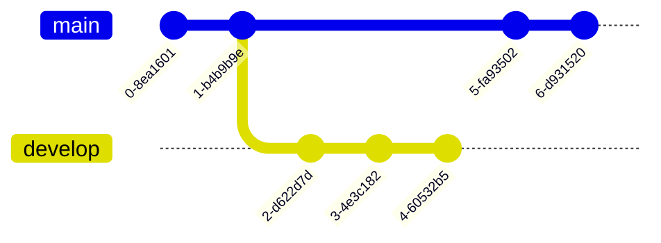

# 💖 💖 💖 About me 💖 💖 💖

### 🤖 Robotics Researcher | Reinforcement Learning | Robot Locomotion & Control

**Ph.D. Student in Computer Science · Wuhan University**

<!--  -->
<!--  -->

I'm a Computer Science Ph.D. student at **Wuhan University**, specializing in robotics, reinforcement learning, and intelligent control systems. My primary interests are **learning-based robot locomotion**, particularly robust control policies for quadrupedal and humanoid robots.

I work at the intersection of **robot dynamics, classical control, deep reinforcement learning, and physics-based simulation**. My long-term goal is to contribute to intelligent robots capable of adapting to challenging real-world environments.

- 🔭 Working on **deep reinforcement learning for legged robot locomotion**
- 🌱 Exploring **sim-to-real transfer, imitation learning, and robust policy learning**
- 🤖 Interested in **Unitree Go2, G1, H1**, and other legged robots
- 🧠 Studying **PPO, teacher–student distillation, domain randomization, and terrain adaptation**
- ⚙️ Building custom robotics simulation and control environments
- 🎯 Career interests: **robotics research, embodied AI, and learning-based control**

---

## 🧠 Research Interests

| Research Area | Focus |
| --- | --- |
| 🤖 Legged Robotics | Quadrupedal and humanoid locomotion |
| 🧠 Deep Reinforcement Learning | PPO, actor–critic, policy optimization |
| 🎓 Imitation Learning | Teacher–student distillation, DAgger |
| 🌍 Sim-to-Real Transfer | Domain randomization, robustness, deployment |
| ⚙️ Robot Control | PID, PD, LQR, trajectory tracking; exploring MPC |
| 📐 Robot Dynamics | Kinematics, dynamics, Jacobians, system modeling |
| 🏔️ Terrain Adaptation | Rough-terrain locomotion and terrain-aware policies |
| 🔬 Embodied AI | Learning-based intelligent robotic systems |

---

## 🛠️ Robotic Skills & Tools

**Robotics:** Isaac Lab, Isaac Sim, Isaac Gym, MuJoCo, ROS 2 Jazzy, Gymnasium, RSL-RL, URDF, MJCF, USD.

**Mathematics & control:** Forward/inverse kinematics, robot dynamics, Jacobians, quaternion orientation, PD/PID, LQR, trajectory generation and tracking. Exploring iLQR, MPC, and NMPC.

### 🧠 Machine Learning & Reinforcement Learning

- Proximal Policy Optimization (PPO) and actor–critic reinforcement learning
- Teacher–student policy distillation and imitation learning
- Domain randomization and curriculum learning
- Privileged learning and history-based policies
- Policy evaluation and deployment workflows

### ⚙️ Robotics Mathematics & Control

- Forward and inverse kinematics
- Robot dynamics and equations of motion
- Jacobian-based velocity analysis
- Trajectory generation and tracking
- PID / PD control and Linear Quadratic Regulator (LQR)
- Model Predictive Control (MPC) — exploring
- State estimation, quaternions, and rotation matrices

---

## 🔬 Research Projects

### 🦿 1. Learning-Based Legged Robot Locomotion

**Technologies:** Isaac Lab, PyTorch, RSL-RL, PPO, Python  
**Platforms:** Unitree Go2, H1, G1

Developing and experimenting with reinforcement learning environments and control policies for quadrupedal and humanoid locomotion. Areas include rough-terrain training, reward engineering, domain randomization, curricula, privileged teacher–student training, and sim-to-real robustness.

### 🏔️ 2. LiTAG — Terrain-Adaptive Robot Locomotion

**Lipschitz-Regularized, Distilled, Terrain-Adapted Gait**

A research-oriented approach combining Lipschitz regularization, privileged distillation, terrain-relative base height, terrain height preview, and adaptive gait learning. The objective is to improve locomotion stability and trajectory tracking on challenging terrain.

### ⚖️ 3. Two-Wheeled Self-Balancing Robot

**Technologies:** MuJoCo, Python, NumPy, Gymnasium

Built a custom MJCF robot model and simulation environment, with IMU/quaternion state estimation, PD/PID and LQR controllers, Jacobian-based velocity computation, motor torque control, and a custom reinforcement learning environment with reward design.

### 🎮 4. Reinforcement Learning From Scratch

**Technologies:** Python, PyTorch, NumPy, Gymnasium

Experiments with policy gradients, actor–critic methods, PPO, rollout collection, generalized advantage estimation, reward engineering, teacher–student distillation, and domain randomization using CartPole and custom robot environments.

### 🦾 5. Robot Simulation & Control Environments

**Technologies:** Isaac Sim, Isaac Lab, MuJoCo, ROS 2

Working with URDF, MJCF, and USD models; articulations and joints; rigid-body physics and collisions; actuators and sensors; parallel RL environments; and simulation validation/debugging.

### 🚀 6. Sim-to-Real Robot Policy Deployment

**Technologies:** Unitree SDK, ROS 2, Isaac Lab, Python

Exploring policy export, observation/action interfaces, joint-command mapping, simulation-to-simulation validation, ROS 2 integration, and deployment workflows for the Unitree Go2. **Physical-robot deployment is a goal, not a claimed completed result.**

---

## 🎯 Research Goals

1. **Robust Locomotion:** Traverse complex and unpredictable environments.
2. **Adaptive Learning:** Generalize across terrains and robot dynamics.
3. **Sim-to-Real Transfer:** Reduce the gap between simulation and physical robots.
4. **Efficient Learning:** Improve policies through distillation and regularization.
5. **Embodied Intelligence:** Develop robots that learn increasingly complex physical behaviors.

---

## 📈 GitHub Statistics

  <!-- Overview -->
  <picture>
    <source
      media="(prefers-color-scheme: dark)"
      srcset="./assets/overview.dark.svg"
    />
    
  </picture>

    

  <!-- Lifetime Contributions -->
  <picture>
    <source
      media="(prefers-color-scheme: dark)"
      srcset="./assets/lifetime.dark.svg"
    />
    
  </picture>

> GitHub statistics are provided by a third-party service and may occasionally be unavailable or rate-limited.

---

## 🤝 Let's Connect

I'm interested in collaborating on **robotics reinforcement learning, quadrupedal and humanoid locomotion, learning-based control, sim-to-real transfer, and embodied AI**.

📍 **Wuhan University, China**  
🎓 **Computer Science | Robotics | Reinforcement Learning**  
💬 [GitHub: @vividblueprint](https://github.com/vividblueprint)

### 💡 Research Philosophy

> Building intelligent robots that don't just follow predefined motions, but learn how to move, adapt, and interact with the physical world.

⭐ **Thanks for visiting my GitHub profile!**

